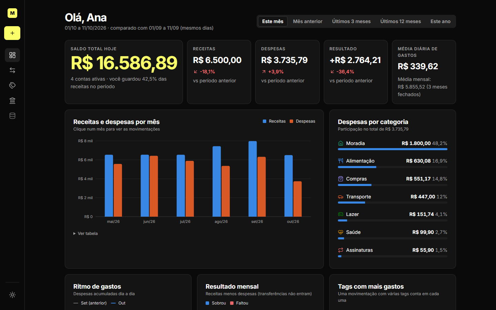
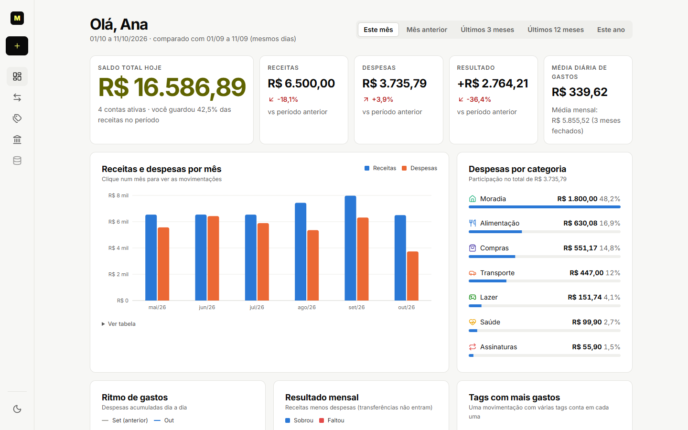
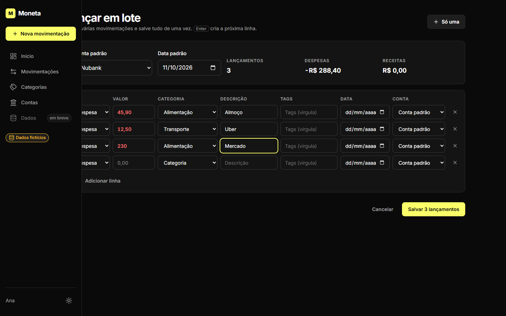
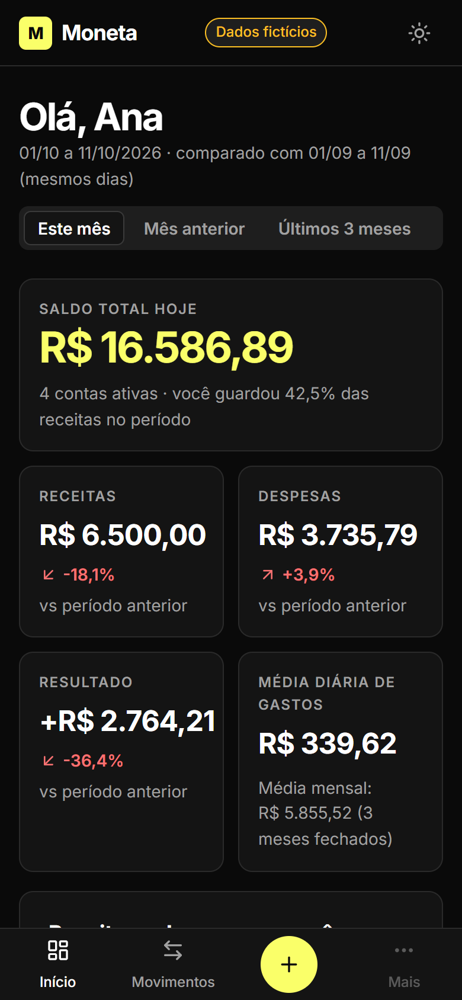
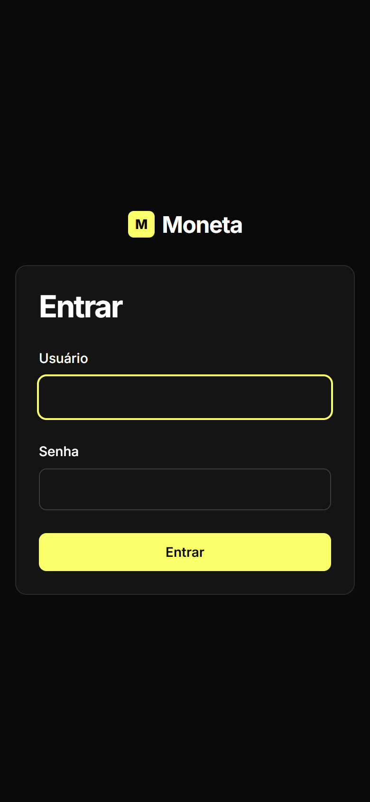

# Moneta

[](https://github.com/giovaniolivr/Moneta/actions/workflows/ci.yml)

Plataforma de gestão e planejamento financeiro pessoal: registro rápido de movimentações,
dashboard analítica e, no futuro, objetivos, simulação de investimentos e estratégias de compra.

Uso pessoal por enquanto, com arquitetura pronta para multiusuário e clientes web/mobile.
Detalhes técnicos em [`docs/ARQUITETURA.md`](docs/ARQUITETURA.md) e decisões em [`docs/adr/`](docs/adr/).

## Telas



| Tema claro | Lançamento em lote |
|---|---|
|  |  |

<p>
  
  
</p>

_Capturas com dados fictícios._

## Stack

Python 3.14 · Django 6.1 · SQLite · CSS e gráficos SVG próprios (sem build, sem dependências JS) ·
pytest · ruff · mypy (strict)

## Status

**Fase 1 — MVP (registro financeiro e dashboard)**

- [x] 0. Esqueleto: settings por ambiente, usuário customizado, login obrigatório, CSP, testes
- [x] 1. Valores monetários (centavos ↔ R$): parser tolerante, formatação BRL, campo de formulário
- [x] 2. Contas e categorias (padrões criados por usuário, nomes únicos sem caixa/acentos)
- [x] 3. Tags com normalização, apelidos, mesclagem explícita e busca para autocomplete
- [x] 4. Movimentações (receitas, despesas, transferências) com regras garantidas no banco e saldo por conta
- [x] 5. Layout base e temas escuro/claro (CSS próprio sem build, contraste WCAG AA testado)
- [x] 6. Registro rápido de movimentação em painel lateral (celular: painel inferior)
- [x] 6b. Lançamento em lote: várias movimentações numa tela, totais ao vivo, rascunho salvo, grava tudo ou nada
- [x] 7. Lista com filtros combináveis (período, tipo, categoria, tag, conta, pagamento, busca), edição e exclusão
- [x] 7b. Telas de categorias (cor e ícone), tags (apelidos, mesclar) e contas (saldo líquido, cartão como dívida)
- [x] 8. Motor de indicadores (comparação pro-rata, médias de meses fechados, detalhamentos)
- [x] 9. Dashboard com gráficos acessíveis, tabela equivalente e drill-down para a lista
- [x] 10. Análises automáticas (resumo, acima da média, tendência, concentração, dia da semana) com evidência numérica e aviso de dados insuficientes
- [x] 11. Seções secundárias da dashboard: comparativo mês a mês por categoria (com tendência e média), variação de tags e formas de pagamento
- [x] 12. Exportação JSON completa e CSV (Excel pt-BR), importação com prévia (idempotente, tudo ou nada) e backup do SQLite com rotação
- [ ] 13. Polimento, acessibilidade e PWA

**Próximas fases:** planejamento (metas, recorrências, parcelamentos, orçamentos) →
simulador de investimentos e estratégias de compra → pesquisa de preços → assistente com IA.

## Rodando localmente

Requer [uv](https://docs.astral.sh/uv/) (instala o Python 3.14 automaticamente).

```bash
uv sync
cp .env.example .env            # e gere uma DJANGO_SECRET_KEY (instrução no arquivo)
uv run python manage.py migrate
uv run python manage.py seed_demo   # ~6 meses de dados fictícios (usuário "demo")
uv run python manage.py runserver
```

Em desenvolvimento o banco padrão é o **`db-demo.sqlite3`, só com dados fictícios** (a interface
mostra o aviso "Dados fictícios"). `seed_demo` pode ser rodado de novo a qualquer momento para
recriar os dados. Para usar dados reais, aponte `DATABASE_URL=sqlite:///db.sqlite3` no `.env` e
crie seu usuário com `createsuperuser`.

Acesse http://127.0.0.1:8000 — em desenvolvimento o login é automático (somente localhost; desative com
`DEV_AUTO_LOGIN=0` no `.env`). Não há cadastro público.

## Backup e portabilidade

- **Tela Dados** (`/dados/`): exportar tudo em JSON, movimentações em CSV e importar um JSON com
  prévia. Na lista de movimentações, "Exportar CSV" respeita os filtros aplicados.
- **Backup do banco:** `uv run python manage.py backup` grava uma cópia consistente em `backups/`
  (mantém as 10 mais recentes; `--destino PASTA`, `--manter N`). Para automatizar no Windows, crie
  uma tarefa diária no Agendador de Tarefas com esse comando, iniciando na pasta do projeto.

## Qualidade

```bash
uv run pytest            # testes
uv run ruff check .      # lint
uv run ruff format .     # formatação
uv run mypy .            # tipagem
```
